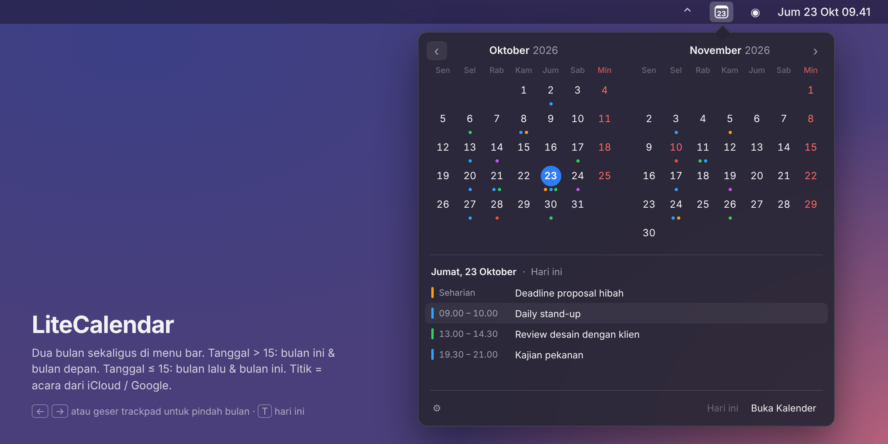

# LiteCalendar

Kalender **dua bulan** untuk menu bar macOS, lengkap dengan acara dari kalender di Mac Anda
(iCloud, Google, Exchange, dll.). Dibuat dengan Swift + AppKit murni, satu file sumber, tanpa dependensi.



> Gambar di atas adalah mockup. Tampilan asli bisa sedikit berbeda.

## Fitur

- Ikon tanggal di menu bar (atau teks `Jum 23 Okt`), otomatis ikut tema terang/gelap
- Klik ikon → **dua bulan berdampingan**:
  - tanggal **> 15**: kiri bulan ini, kanan bulan depan
  - tanggal **≤ 15**: kiri bulan lalu, kanan bulan ini
- Tombol **‹ ›** untuk pindah ke bulan lebih lama / lebih baru, juga lewat tombol **← →**,
  geser dua jari di trackpad, atau roda mouse. **Hari ini** (atau tombol **T**) kembali ke tampilan awal
- **Titik acara** di setiap tanggal (warna = warna kalender, maks. 3 titik)
- Klik tanggal → daftar acara hari itu di bawah kalender; klik acara → dibuka di aplikasi Kalender
- Hari Minggu dan hari libur (kalender bernama "Libur"/"Holiday") berwarna merah
- Pilih kalender yang ditampilkan, hari pertama minggu (Senin / Minggu), buka saat login
- Update dan uninstall langsung dari menu (klik kanan ikon, atau ⚙︎ di popover)

## Menghubungkan Google Calendar

LiteCalendar membaca acara lewat **EventKit**, yaitu kalender bawaan macOS. Jadi akun Google cukup
dihubungkan sekali di macOS (login Google dilakukan oleh Apple, LiteCalendar tidak pernah melihat password
atau token Anda):

1. Klik kanan ikon LiteCalendar → **Tambah akun Google / lainnya…**
   (atau buka **Pengaturan Sistem → Akun Internet**).
2. Pilih **Google**, login, lalu aktifkan **Kalender**.
3. Saat LiteCalendar pertama kali dibuka, klik **Izinkan** pada permintaan akses Kalender.

Acara Google langsung tampil dan ikut diperbarui saat macOS menyinkronkan kalender.
Kalender tertentu (mis. Ulang Tahun) bisa disembunyikan lewat **Kalender yang ditampilkan**.

Kalau akses pernah ditolak: **Pengaturan Sistem → Privasi & Keamanan → Kalender** → aktifkan LiteCalendar.

## Instalasi

**Opsi A: unduh `.app` jadi (tanpa Xcode)**

1. Unduh `LiteCalendar.zip` dari halaman [Releases](../../releases).
2. Ekstrak, lalu pindahkan `LiteCalendar.app` ke folder **Applications**.
3. Karena aplikasi belum ditandatangani Apple, hapus tanda karantina sekali saja:
   ```bash
   xattr -cr /Applications/LiteCalendar.app
   open /Applications/LiteCalendar.app
   ```

**Opsi B: installer (compile di Mac sendiri)**

Butuh Xcode Command Line Tools. Installer akan menawarkan pemasangan kalau belum ada.

```bash
bash ~/Downloads/install-LiteCalendar.command
```

**Opsi C: build dari source**

```bash
git clone https://github.com/kikiraihan/mac-os-calendar-two-sided.git
cd mac-os-calendar-two-sided
./scripts/build.sh
cp -R build/LiteCalendar.app /Applications/
```

> Aplikasi ditandatangani ad-hoc, jadi setelah update macOS bisa meminta izin Kalender sekali lagi.

## Pintasan

| Aksi | Cara |
|---|---|
| Buka / tutup kalender | klik ikon |
| Menu pengaturan | klik kanan ikon, atau ⚙︎ di popover |
| Bulan sebelumnya / berikutnya | ‹ › · ← → · geser trackpad · roda mouse |
| Kembali ke hari ini | **Hari ini** · T |
| Lihat acara tanggal lain | klik tanggalnya |

## Update

Klik kanan ikon → **Cek pembaruan…**. LiteCalendar mengecek rilis terbaru di halaman Releases GitHub
(otomatis juga saat dibuka dan sehari sekali). Pilih **Update sekarang**: `LiteCalendar.zip` diunduh,
`LiteCalendar.app` lama diganti, lalu aplikasi dibuka lagi. Pengaturan tetap tersimpan.

## Uninstall

Klik kanan ikon → **Uninstall LiteCalendar…**. LiteCalendar dihapus dari "Buka saat login", pengaturan dan
izin Kalendernya dihapus, lalu `LiteCalendar.app` dipindahkan ke Tong Sampah. Acara di kalender tidak tersentuh.

Atau manual lewat Terminal:

```bash
pkill -x LiteCalendar
rm -rf /Applications/LiteCalendar.app
defaults delete id.local.litecalendar
tccutil reset Calendar id.local.litecalendar
```

## Struktur repo

```
mac-os-calendar-two-sided/
├── Sources/LiteCalendar/main.swift   # seluruh kode aplikasi
├── Resources/Info.plist              # metadata bundle (.app) + alasan akses Kalender
├── scripts/
│   ├── build.sh                      # build → build/LiteCalendar.app
│   └── make-installer.sh             # buat dist/install-LiteCalendar.command
├── docs/screenshots/                 # gambar untuk README
└── .github/workflows/build.yml       # build otomatis di macOS + rilis
```

## Rilis

**Otomatis:** naikkan versi di `Resources/Info.plist` (`CFBundleShortVersionString` dan `CFBundleVersion`),
lalu merge ke `main`. GitHub Actions akan build, membuat tag `v<versi>`, dan rilis berisi `LiteCalendar.zip` dan
`install-LiteCalendar.zip`. Setiap push ke branch lain hanya di-build (tanpa rilis).

Aturan penomoran versi (`va.b.c`: major / fitur & style mayor / bugfix & style minor) ada di [AGENTS.md](AGENTS.md).

**Manual:** push tag versi:

```bash
git tag v1.0.0 && git push origin v1.0.0
```

## Syarat

macOS 13 (Ventura) atau lebih baru. Mendukung Apple Silicon dan Intel.
